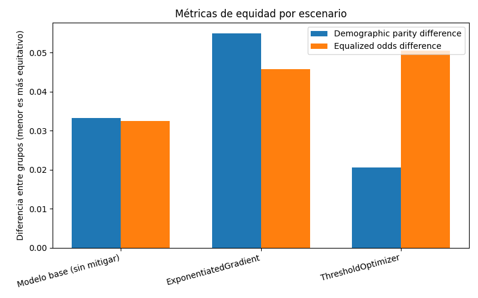
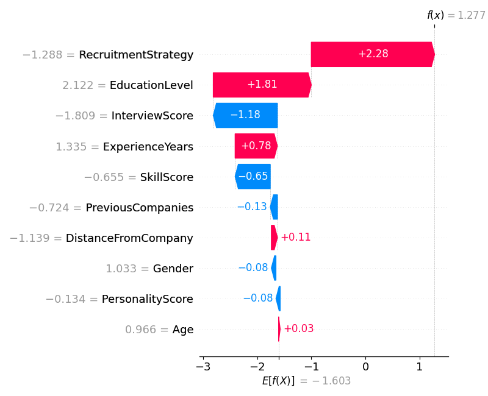
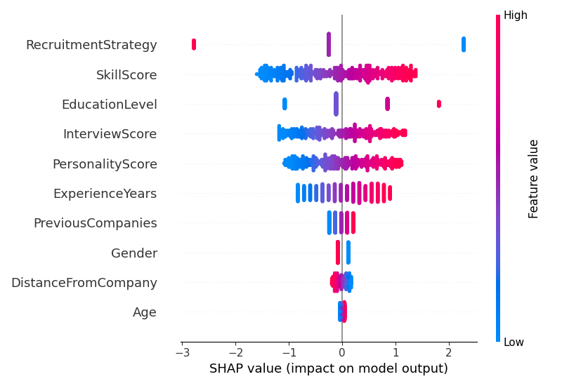

# Evidencias — Auditoría de equidad, mitigación y explicabilidad

_Generado automáticamente el 2026-10-19 21:46._

## Configuración de la corrida

- **Dataset:** data/recruitment_data.csv
- **Columna objetivo:** `HiringDecision` (clase positiva: `1`)
- **Atributo sensible:** `Gender`
- **Método de mitigación:** `ambos`
- **Restricción de equidad:** `demographic_parity`

## Auditoría de equidad — modelo base (pre-mitigación)

- **Exactitud global:** 0.873
- **Demographic parity difference:** 0.033
- **Equalized odds difference:** 0.032

### Métricas por grupo

| Grupo | Exactitud | Tasa de selección |
|---|---|---|
| 0 | 0.873 | 0.236 |
| 1 | 0.874 | 0.270 |

> TODO estudiante: interpretá esta tabla vinculándola con el sesgo documentado en el caso real analizado en la consigna 3 (¿el patrón que ves acá es consistente con lo que reportó el caso?).

## Interpretación
El modelo base obtuvo una exactitud global del 87,3 %, con resultados similares entre hombres (87,3 %) y mujeres (87,4 %). Sin embargo, al analizar las tasas de selección se observa una pequeña diferencia: el modelo predijo una contratación favorable para el 23,6 % de los hombres y el 27,0 % de las mujeres.

Esta diferencia se refleja en las métricas de equidad, con un demographic parity difference de 0,033 y un equalized odds difference de 0,032. Estos valores indican que existen disparidades relativamente pequeñas entre los grupos analizados.

A diferencia del caso de Amazon (2018), donde se identificó un sesgo que perjudicaba a las candidatas mujeres, en mi modelo las mujeres presentan una tasa de selección ligeramente superior. Por lo tanto, no se reproduce el mismo patrón de discriminación.

El análisis demuestra que una buena exactitud general no garantiza necesariamente un comportamiento equivalente entre grupos. Es importante complementar la evaluación tradicional con métricas de equidad que permitan identificar posibles diferencias en las decisiones del modelo.

## Comparación antes / después de la mitigación

| Escenario | Exactitud | Demographic parity diff. | Equalized odds diff. |
|---|---|---|---|
| Modelo base (sin mitigar) | 0.873 | 0.033 | 0.032 |
| ExponentiatedGradient | 0.867 | 0.055 | 0.046 |
| ThresholdOptimizer | 0.876 | 0.021 | 0.050 |

> TODO estudiante: discutí qué tan efectiva resultó la mitigación aplicada y qué limitaciones observaste (consigna 9.c) — por ejemplo, si mejoró la equidad pero bajó la exactitud, o si algún escenario no logró reducir la disparidad.

## Interpretación

Se compararon dos técnicas de mitigación de Fairlearn, ExponentiatedGradient y ThresholdOptimizer, utilizando demographic parity como restricción de equidad.

El modelo base obtuvo una exactitud del 87,3 %, un demographic parity difference de 0,033 y un equalized odds difference de 0,032.

Al aplicar ExponentiatedGradient, la exactitud disminuyó al 86,7 %, mientras que las diferencias de equidad aumentaron a 0,055 y 0,046, respectivamente. Esto indica que la técnica no logró mejorar las métricas de equidad en esta ejecución.

Por otro lado, ThresholdOptimizer obtuvo una exactitud del 87,6 % y redujo el demographic parity difference a 0,021, lo que representa una disminución aproximada del 36,4 % respecto del modelo base. Sin embargo, el equalized odds difference aumentó a 0,050.

Estos resultados muestran que ThresholdOptimizer fue la técnica más efectiva para reducir las diferencias en las tasas de selección entre hombres y mujeres, según la restricción de paridad demográfica utilizada. No obstante, también se observa que mejorar una métrica de equidad puede producir un deterioro en otra.

En conclusión, la mitigación de sesgos no garantiza automáticamente una mejora en todas las dimensiones de equidad. Es necesario evaluar conjuntamente la exactitud, las diferencias entre grupos y los posibles efectos de cada técnica antes de seleccionar un modelo para su utilización en un proceso real de reclutamiento.

Explicabilidad (SHAP) — modelo base

SHAP se aplica siempre sobre el modelo base, antes de cualquier mitigación: el objetivo es ver qué técnica de auditoría preventiva podría haber detectado el problema antes del despliegue (consigna 4).

### Predicción 1 — el atributo sensible más influyó

- Contribución absoluta de `Gender`: 0.112
- Predicción del modelo: 0 · Valor real: 0

### Predicción 0 — el atributo sensible casi no influyó

- Contribución absoluta de `Gender`: 0.085
- Predicción del modelo: 1 · Valor real: 1

### Resumen global

> TODO estudiante: vinculá esta evidencia con la consigna 4 — ¿SHAP sobre el modelo base hubiera permitido detectar este problema antes del despliegue?

## Interpretación

Se utilizó SHAP para analizar la influencia de las variables sobre las predicciones individuales del modelo base, prestando especial atención al atributo sensible Gender.

En la primera predicción, correspondiente a un candidato que no fue contratado, la contribución absoluta del género fue de 0,112. Las variables con mayor influencia fueron EducationLevel, SkillScore e InterviewScore. En este caso, el género tuvo una contribución positiva relativamente pequeña, mientras que otras características influyeron con mayor intensidad en el resultado.

En la segunda predicción, correspondiente a un candidato contratado, la contribución absoluta del género fue de 0,085. Las variables más influyentes fueron RecruitmentStrategy y EducationLevel, mientras que el género presentó una contribución negativa de menor magnitud.

El gráfico de resumen global mostró que RecruitmentStrategy, SkillScore, EducationLevel e InterviewScore se encuentran entre las características con mayor influencia sobre las predicciones, mientras que Gender tiene una importancia relativamente baja.

Estos resultados indican que el género participa en algunas decisiones del modelo, aunque no constituye uno de sus factores principales. Sin embargo, una influencia individual pequeña no permite descartar posibles diferencias sistemáticas entre grupos.

En relación con el caso de Amazon, SHAP podría haber sido útil como herramienta de auditoría preventiva para identificar características de los currículums que influyeran de forma injustificada en la evaluación de candidatos. Su aplicación conjunta con métricas de equidad de Fairlearn permitiría detectar diferencias entre grupos y analizar los factores que contribuyen a las predicciones.

Es importante aclarar que SHAP permite explicar las predicciones, pero no demuestra por sí solo la existencia de discriminación. Por eso, sus resultados deben complementarse con auditorías de equidad y supervisión humana.
