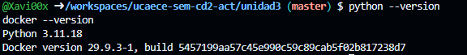
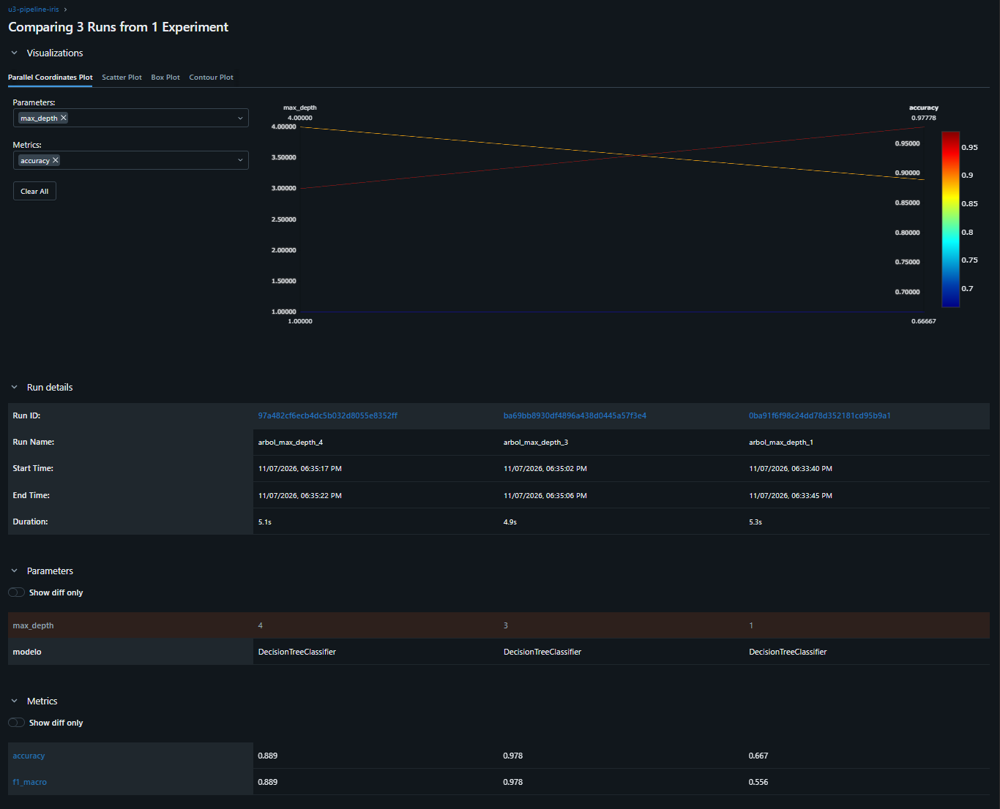
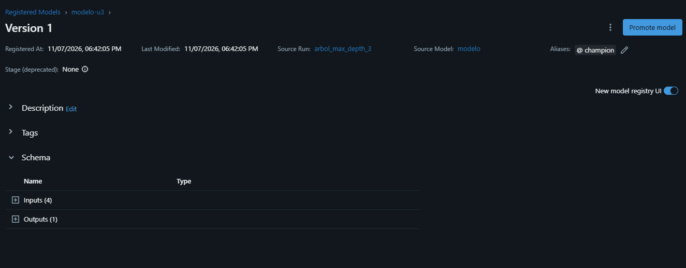
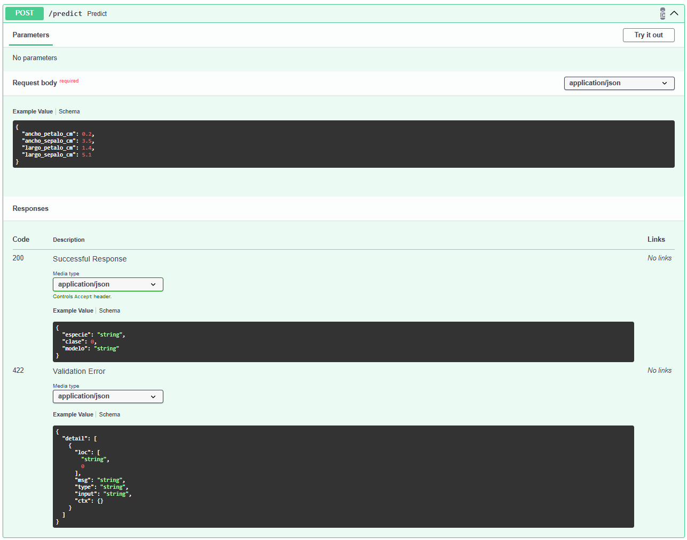
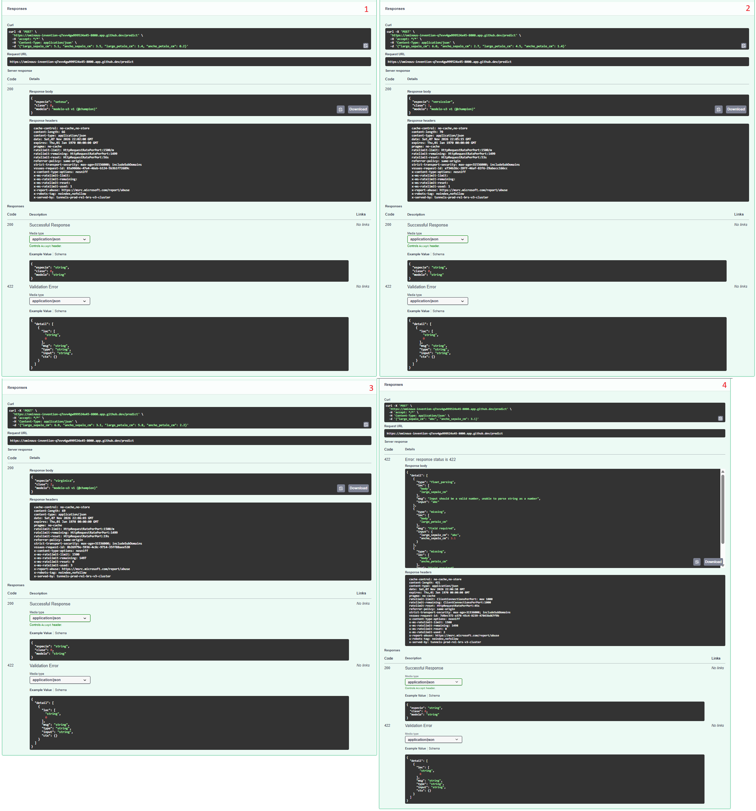
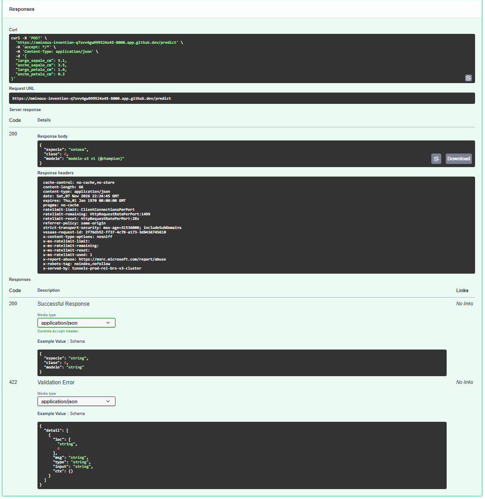

# Resultados — Unidad 3: MLOps/LLMOps

**Estudiante: Demartín Xavier** 

**Fecha: 2026/11/07** 

---

## Consigna 6: Preparación del entorno

---

## Consigna 7: Experimentación y registro con MLflow

| Corrida | max_depth | accuracy | f1_macro |
|---------|-----------|----------|----------|
|        1|          1|     0.667|     0.556|
|        2|          3|     0.978|     0.978|
|        3|          4|     0.889|     0.889|

**Versión registrada:1** modelo-u3 v__ (@champion), corrida con max_depth =3

Al comparar las corridas, se observó que el árbol de decisión con profundidad 3 obtuvo el mejor rendimiento, alcanzando un accuracy y un F1-macro de 0.978. La profundidad 1 presentó resultados inferiores, mientras que aumentar la profundidad a 4 tampoco produjo una mejora. Esto demuestra que un modelo más complejo no necesariamente generaliza mejor. Registrar todas las corridas mediante MLflow permite comparar configuraciones, mantener la trazabilidad de los experimentos y seleccionar la versión más adecuada para producción.

---

## Consigna 8: Serving con FastAPI

| Entrada | Respuesta de la API |
|---------|---------------------|
|        1|     setosa (clase 0)|
|        2| versicolor (clase 1)|
|        3|  virginica (clase 2)|
|        4|Error: response status is 422|

Al enviar una solicitud con datos inválidos, FastAPI rechazó la entrada y devolvió el código HTTP 422, indicando los campos incorrectos o faltantes. La solicitud no llegó a ejecutarse en el modelo, ya que la validación se realizó previamente. Este comportamiento es importante en producción porque evita procesar datos que no cumplen con el contrato de la API, reduce errores y mejora la confiabilidad del servicio frente a solicitudes provenientes de otros sistemas.

---

## Consigna 9: Containerización con Docker

El versionado de las imágenes Docker permitiría mantener la versión estable `modelo-u3:1.0` y desplegar una nueva versión `modelo-u3:1.1` mediante una estrategia canary release. Inicialmente, se dirigiría un porcentaje reducido del tráfico hacia la nueva versión, manteniendo el resto en la anterior. Durante esta etapa se compararían las métricas de rendimiento y los errores de ambas versiones. Si los resultados fueran satisfactorios, se incrementaría progresivamente el tráfico hacia la versión 1.1, de lo contrario, se revertiría a la versión estable.
